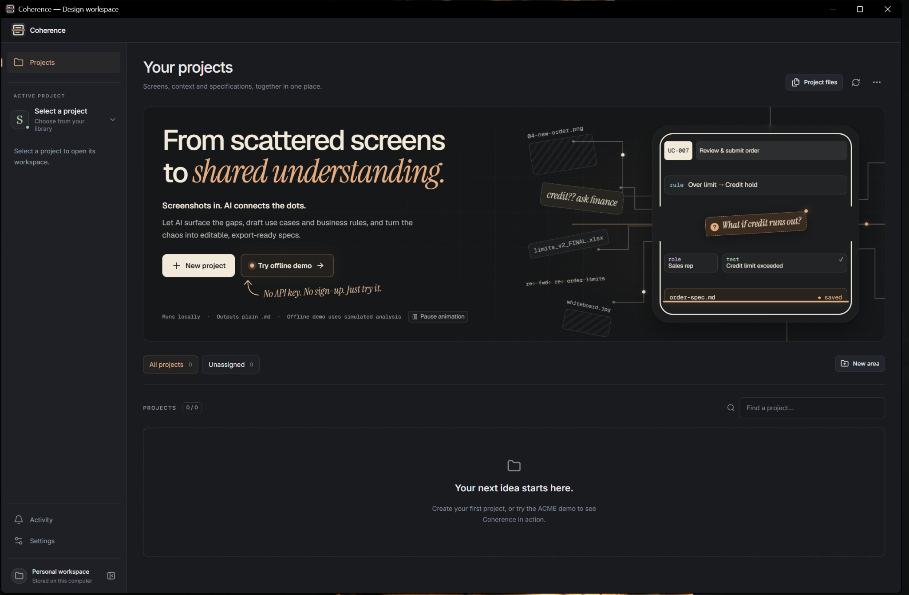
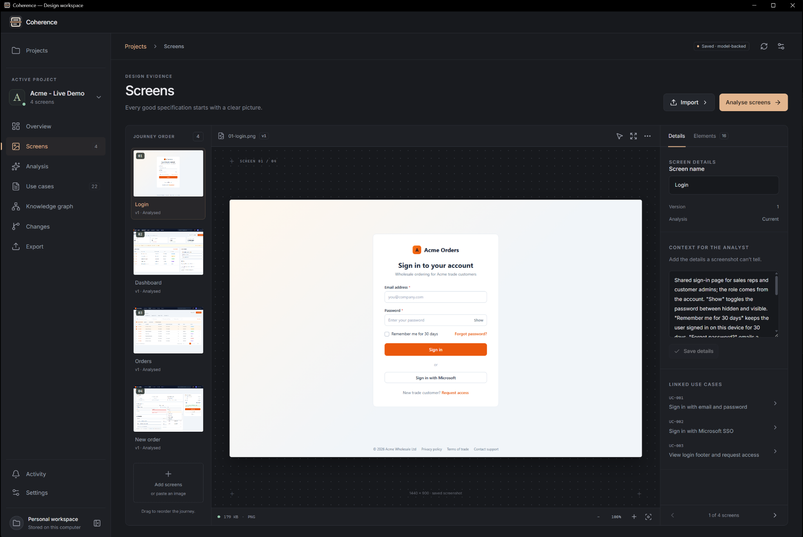
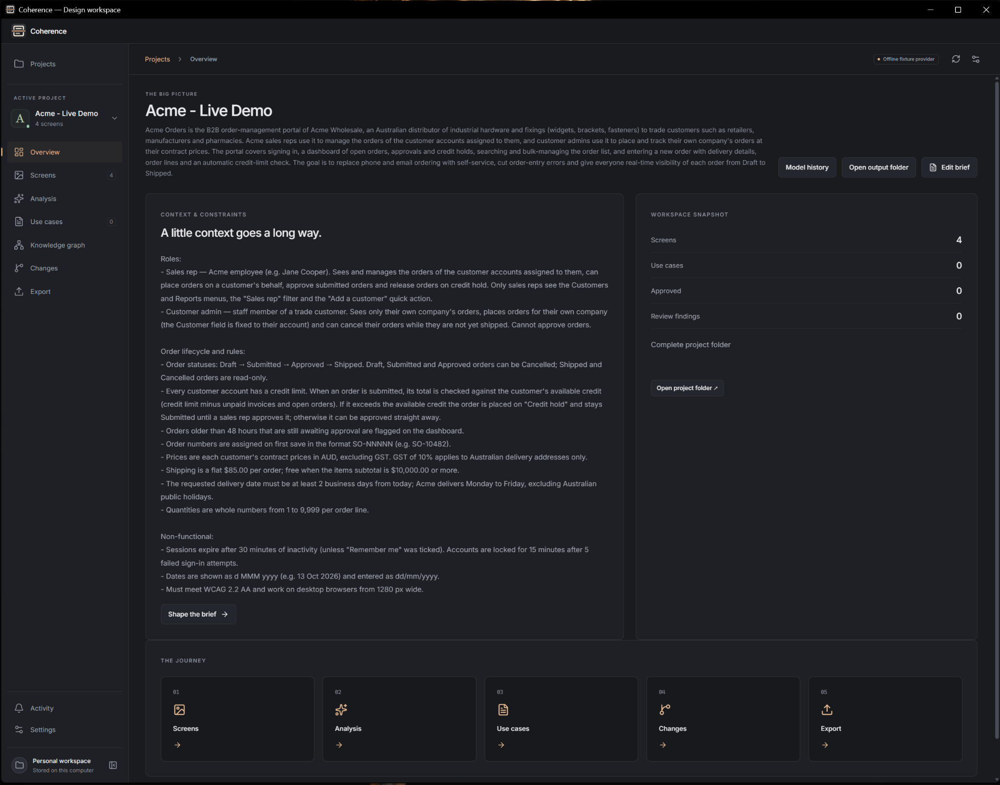
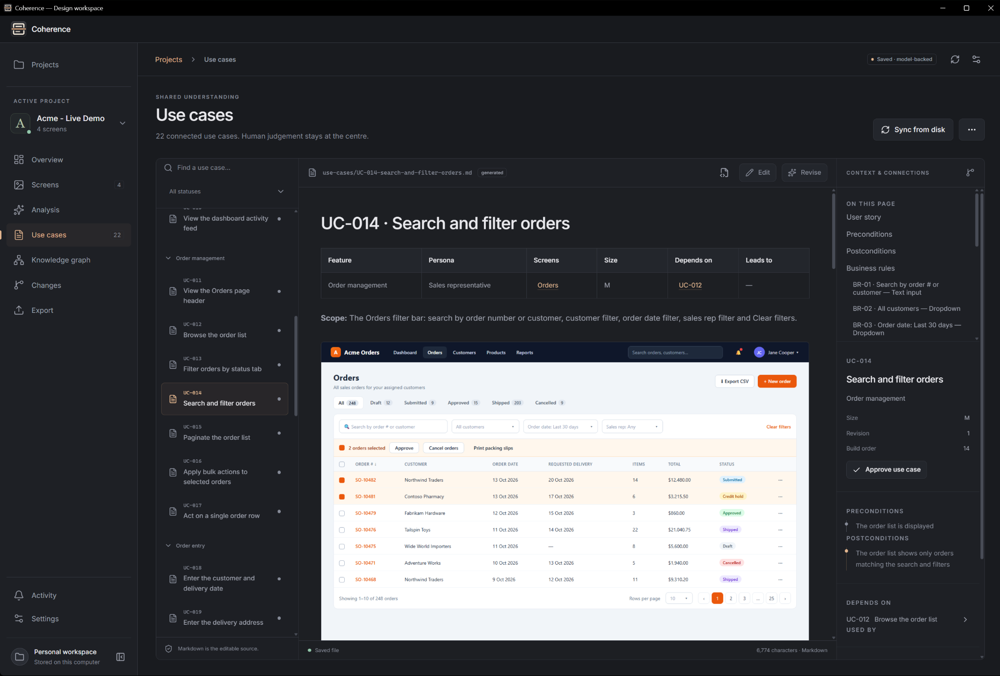
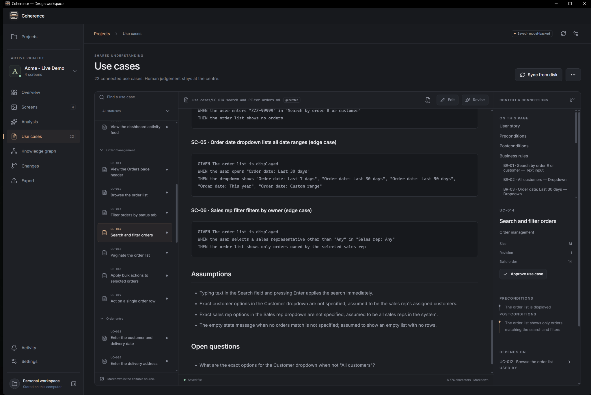
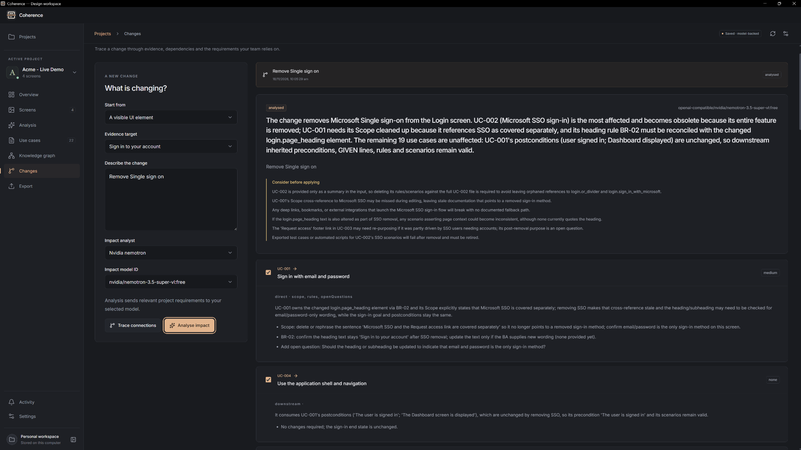
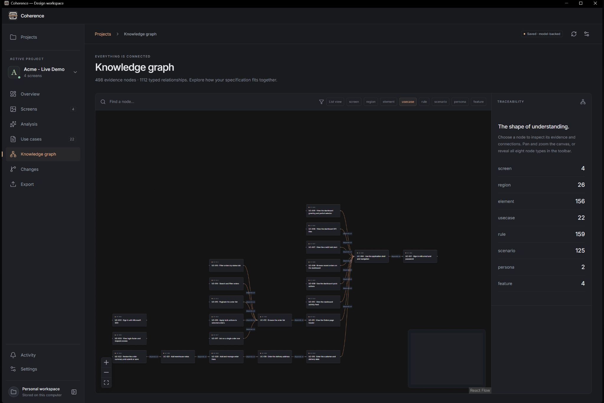
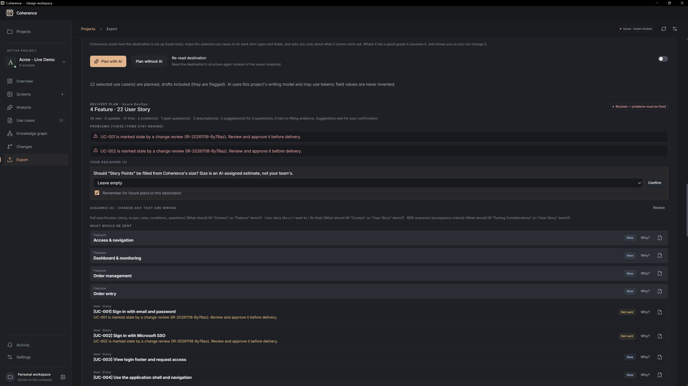
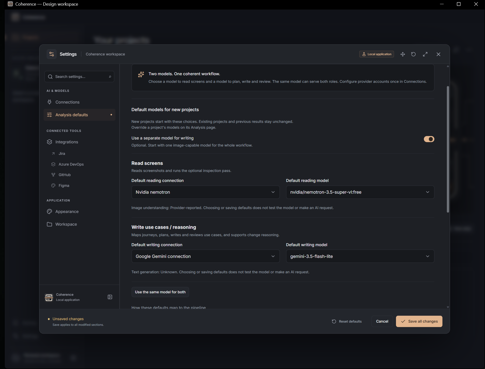
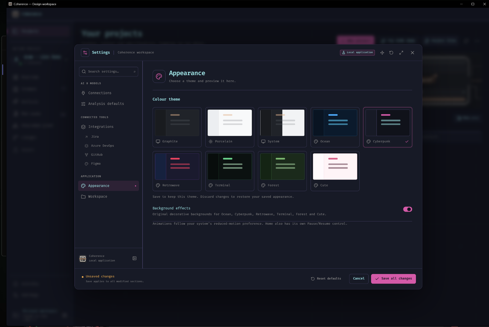

# Coherence

**From screens to specs.**

Coherence is a local, AI-assisted requirements workspace for business analysts, product owners and delivery leads. Give it a collection of UI screenshots and business context, generate use cases, business rules and BDD scenarios in one run, then review, refine and prepare them for your team's backlog.

**[Download the latest Windows release](https://github.com/waxyfeet/coherence/releases/latest)** · [User guide](docs/release/USER_GUIDE.md) · [Release notes (v0.2)](docs/release/RELEASE_NOTES_0.2.0.md)

## From screens to specs

### 1. Screenshots and context

Add screenshots or import Figma frames. Provide the business rules, user roles and constraints that the UI alone can't tell you. Coherence analyses the screens together rather than making you work through them one at a time.

Example project brief

### 2. Generate and refine your requirements

In one run using four screens from the fictional Acme Orders portal and accompanying context, Coherence generated **22 use cases, 159 business rules and 125 BDD scenarios** for review. Results vary by model and input.

Use cases are editable Markdown files with links back to their source screens. Review assumptions, answer open questions, revise the requirements yourself or ask AI to propose changes. Approve them when you're happy.

Example BDD scenarios, assumptions and open questions

### 3. Keep the specification connected

The knowledge graph links screens, use cases, rules and scenarios. Change something and Coherence can propose updates to affected requirements for you to review, rather than expecting you to remember every prior decision.

For example, removing Microsoft single sign-on flags an obsolete use case and references to it elsewhere in the specification.

Explore the knowledge graph

### 4. Prepare for delivery

Coherence discovers the configuration of your Azure DevOps, Jira or GitHub destination and proposes how to map the approved requirements to its work items and fields. Review the plan, resolve blockers and confirm before publishing. CSV export is available too.

## Get started

1. Download `Coherence-<version>-Setup.exe` from [Releases](https://github.com/waxyfeet/coherence/releases/latest) and run it on **Windows 11 (64-bit)**. No separate Node.js installation or administrator rights required.
2. Try the built-in offline Acme Orders demo. It uses sample output and doesn't require an API key.
3. To analyse your own screens, connect an AI provider or a compatible local model in Settings.
4. Create a project, add your screens and context, then select **Analyse screens**.

**Installer note:** v0.2 is unsigned, so Windows SmartScreen may warn or block. Only run the installer if you trust the source. See the [installation guide](docs/release/USER_GUIDE.md) for verification and installation instructions. IT administrators: see the [IT note](docs/release/IT_NOTE.md).

## AI models

Bring your own API key or use a compatible local model. Coherence supports Anthropic, OpenAI, Azure OpenAI, Gemini, Ollama and OpenAI-compatible services such as OpenRouter.

You don't need a frontier model to get useful results. I've had good results with Gemini 3.5 Flash-Lite via Google AI Studio and NVIDIA Nemotron 3.5 Super VL via OpenRouter, both free-tier options when I tested them. Nemotron took longer but produced more detailed requirements. I've also tested Claude Opus. Experiment with different models to find what works for you.

**Tip:** On OpenRouter, look for model IDs ending in `:free`. Free tiers have limits and can change. Choose a vision-capable model to read screenshots; you can use a different model to write your specs.

Separate models for screen analysis and use-case generation

## Your data

- Projects, screenshots and editable specifications are stored on your PC as local files.
- Coherence has no account or cloud service of its own and no telemetry. Data goes to the AI services you choose and to any tracker you explicitly publish to.
- Saved keys and tokens are protected by Windows for your account.

See [privacy and data flow](docs/release/PRIVACY_AND_DATA_FLOW.md).

## Roadmap

The bones of v0.2 are ready to share. A few things I'd like to explore next:

- **Coherence Guardian:** Optional, read-only codebase analysis to surface existing business rules, conflicting assumptions, shared concepts and knock-on effects. Give the BA better questions to ask before development starts; technical implementation remains the developer's domain.
- **Meeting transcript import:** Bring stakeholder workshop transcripts into the project with traceability back to the conversations that informed the requirements.
- **Open Questions Workbench:** Investigate and resolve open questions across the entire specification in one place, with AI assistance where useful.
- **Voice-driven refinement:** Dictate changes to use cases, then review and approve proposed amendments.

These are planned ideas, not functionality available in v0.2 or release-date commitments.

## An early release

AI output needs human review. Tracker publishing is new; try it against a test project first. The [release notes](docs/release/RELEASE_NOTES_0.2.0.md) cover known limitations.

The thinking behind Coherence: [Coherence is the new Cost](https://www.linkedin.com/pulse/coherence-new-cost-deon-fouche-crjuc/).

Give it a crack. I'm particularly interested in what you think I've got wrong. [Open an issue](https://github.com/waxyfeet/coherence/issues) with feedback or a bug report. Please don't include credentials or confidential project data.

## Build, contribute and report security issues

- [Build from source](CONTRIBUTING.md#build-from-source) · [Build the installer](packaging/README.md) · [Architecture](docs/ARCHITECTURE.md)
- [Contributing](CONTRIBUTING.md) · [Security](SECURITY.md) · [MIT licence](LICENSE)
- **Credits:** six themes are adapted from [Odysseus](https://github.com/odysseus-dev/odysseus), with its copyright holders' written permission ([record](docs/licenses/Odysseus-themes-permission.md)). Third-party notices are in [public/THIRD_PARTY_NOTICES.txt](public/THIRD_PARTY_NOTICES.txt), with provenance notes in [docs/licenses](docs/licenses/README.md).

And before you ask, yes, it comes in hot pink too.

See the themes

